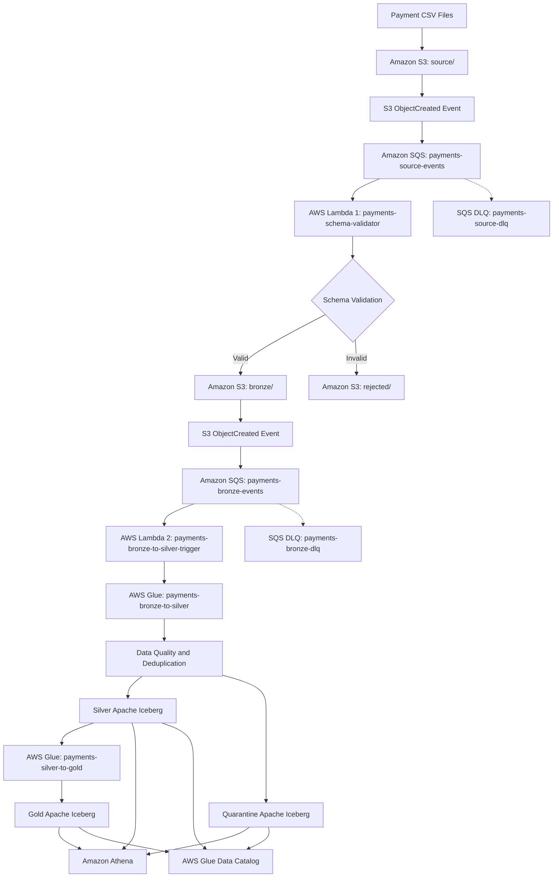

# AWS Payments Lakehouse PoC
## Event-Driven Data Ingestion with S3, SQS, AWS Lambda, AWS Glue, Apache Iceberg and Athena

An event-driven Payments Data Lakehouse Proof of Concept (PoC) built using AWS serverless services.

The solution demonstrates how payment transactions can be ingested from CSV files, validated, routed to Bronze storage, transformed into curated Silver datasets using AWS Glue PySpark, and stored as Apache Iceberg tables for downstream analytics.

The architecture follows the **Medallion Architecture** pattern and incorporates event-driven processing, data quality, deduplication, idempotency, quarantine handling, retries and observability.

---

## 1. Architecture Overview



### Processing flow

1. A payment CSV file is uploaded to the S3 `source/` prefix.
2. S3 generates an ObjectCreated event.
3. The event is delivered to an Amazon SQS queue.
4. Lambda 1 consumes the event and validates the CSV schema.
5. Valid files are copied to the `bronze/` prefix.
6. Invalid files are routed to the `rejected/` prefix with error details.
7. A new Bronze object triggers a second SQS queue.
8. Lambda 2 consumes the event and starts the Bronze-to-Silver Glue job.
9. AWS Glue validates, deduplicates and enriches payment records.
10. Valid payments are merged into a Silver Apache Iceberg table.
11. Invalid payment records are written to a quarantine Iceberg table.
12. A downstream Glue job can produce Gold analytical datasets.
13. Amazon Athena queries curated Iceberg tables.

The architecture uses SQS to decouple ingestion from processing and improve resilience during transient failures.

---

## 2. Technology Stack

| Technology | Purpose |
|---|---|
| Amazon S3 | Source, Bronze, Silver and Gold storage |
| Amazon SQS | Event buffering and asynchronous delivery |
| AWS Lambda | Schema validation and Glue orchestration |
| AWS Glue | Serverless PySpark data transformation |
| Apache Spark | Distributed data processing |
| Apache Iceberg | Transactional lakehouse table format |
| AWS Glue Data Catalog | Metadata management |
| Amazon Athena | Serverless SQL analytics |
| Amazon CloudWatch | Logs and monitoring |
| AWS IAM | Service permissions and role-based access |
| AWS Organizations | Organizational permission guardrails |

### AWS environment

| Property | Value |
|---|---|
| AWS Region | `us-east-1` |
| S3 Bucket | `payments-poc-bucket` |
| Runtime | Python 3.12 for Lambda |
| Glue Runtime | AWS Glue 5.0 |
| Storage format | CSV and Apache Iceberg |
| Processing pattern | Event-driven micro-batch |

---

## 3. Amazon S3 Structure

The PoC uses the following logical storage structure:

```text
payments-poc-bucket/
│
├── source/
│   └── payments_valid.csv
│
├── bronze/
│   └── <hash>_payments_valid.csv
│
├── rejected/
│   ├── <hash>_payments_invalid.csv
│   └── <hash>_payments_invalid.csv.error.json
│
├── silver/
│   └── payment_events/
│       ├── data/
│       └── metadata/
│
├── quarantine/
│   └── payment_events/
│       ├── data/
│       └── metadata/
│
└── gold/
    └── ...
```

**Storage responsibilities**

- **Source:** Landing zone for incoming payment CSV files.
- **Bronze:** Validated source files retained for downstream processing.
- **Rejected:** Files that fail initial schema validation.
- **Silver:** Curated, deduplicated payment records stored in Iceberg.
- **Quarantine:** Records failing business-level data quality checks.
- **Gold:** Business-oriented aggregated datasets.

The Bronze layer currently stores CSV objects. It is not an Iceberg table in the event-driven pipeline.

---

## 4. Source Payment CSV Schema

The ingestion pipeline uses the six-column `payments_valid.csv` schema.

### Sample input

```csv
payment_id,customer_id,amount,currency,status,payment_timestamp
P001,C101,250.00,GBP,COMPLETED,2026-10-25T10:30:00Z
P002,C102,125.50,GBP,PENDING,2026-10-25T10:31:00Z
P003,C103,300.00,GBP,COMPLETED,2026-10-25T10:32:00Z
```

These are illustrative test records.

### Schema definition

| Column | Data type | Description |
|---|---|---|
| payment_id | STRING | Unique payment identifier for this PoC |
| customer_id | STRING | Customer identifier |
| amount | DECIMAL(18,2) | Payment amount |
| currency | STRING | ISO-style currency code |
| status | STRING | Payment status |
| payment_timestamp | TIMESTAMP | Payment timestamp |

### Expected business validation

- `payment_id` must not be null or empty.
- `customer_id` must not be null or empty.
- `amount` must be numeric and greater than zero.
- `currency` must be one of `GBP`, `EUR` or `USD`.
- `status` must be one of `COMPLETED`, `PENDING` or `FAILED` for the current sample contract.
- `payment_timestamp` must be parseable.

The allowed currency and status values should ultimately come from an agreed upstream data contract.

---

## 5. Lambda 1 — Source CSV Schema Validator

**Lambda function**

```text
payments-schema-validator
```

### Responsibilities

Lambda 1 performs initial ingestion validation before a CSV file enters the Bronze layer.

Its responsibilities include:

1. Consume SQS messages containing S3 event notifications.
2. Extract the S3 bucket and object key.
3. Read the uploaded CSV file.
4. Validate the expected CSV headers.
5. Apply the configured source validation rules.
6. Route valid files to Bronze.
7. Route invalid files to Rejected.
8. Generate validation error details.
9. Record processing information in CloudWatch.

### Expected CSV headers

```python
EXPECTED_COLUMNS = [
    "payment_id",
    "customer_id",
    "amount",
    "currency",
    "status",
    "payment_timestamp"
]
```

### Valid file routing

```text
source/payments_valid.csv
         |
         v
payments-schema-validator
         |
         v
bronze/<hash>_payments_valid.csv
```

### Invalid file routing

```text
source/payments_invalid.csv
         |
         v
payments-schema-validator
         |
         v
rejected/<hash>_payments_invalid.csv
rejected/<hash>_payments_invalid.csv.error.json
```

The hash-based destination naming helps avoid accidental collisions and supports deterministic routing for repeated processing of the same source object.

For production, object versioning or an immutable source-object identity should be incorporated into the idempotency design.

### Lambda 1 configuration

| Property | Configuration |
|---|---|
| Runtime | Python 3.12 |
| IAM role | `PaymentsSchemaValidatorRole` |
| Timeout | 30 seconds |
| SQS batch size | 1 |
| SQS visibility timeout | 180 seconds |
| Partial batch response | Enabled |
| Maximum receives | 5 |
| DLQ | `payments-source-dlq` |

### Implementation status

**Validated:** Valid CSV files reach Bronze and invalid files are routed to Rejected.

---

## 6. Amazon SQS — Source Ingestion Queue

**Main queue**

```text
payments-source-events
```

**Dead-letter queue**

```text
payments-source-dlq
```

Amazon SQS decouples S3 event generation from Lambda execution.

### Benefits

- Buffers incoming file notifications.
- Handles traffic bursts.
- Supports retries after transient Lambda failures.
- Reduces coupling between ingestion and validation.
- Preserves failed messages for investigation using a DLQ.

### Delivery semantics

SQS Standard queues provide at-least-once delivery.

Therefore, the same S3 event can be delivered multiple times.

Lambda processing must be designed to tolerate duplicates.

### Failure handling

When processing fails:

1. The Lambda handler returns a failed batch item.
2. The SQS message becomes visible again after its visibility timeout.
3. Lambda can retry processing.
4. After the configured maximum receive count, the message can move to the DLQ.

A message should only be acknowledged as successful when the intended processing action has completed successfully.

---

## 7. Lambda 2 — Bronze-to-Silver Glue Trigger

**Lambda function**

```text
payments-bronze-to-silver-trigger
```

**Execution role**

```text
PaymentsBronzeToSilverTriggerRole
```

### Responsibilities

Lambda 2 is responsible for orchestration, not data transformation.

It performs the following:

1. Consume SQS messages from the Bronze event queue.
2. Parse the S3 event notification.
3. Extract the Bronze bucket and object key.
4. Verify the object belongs to the expected Bronze CSV prefix.
5. Call the AWS Glue `StartJobRun` API.
6. Pass the specific Bronze object to the Glue job.
7. Log the Glue job run ID.
8. Return failed SQS message identifiers when processing fails.

### Bronze event queue

```text
payments-bronze-events
```

### Dead-letter queue

```text
payments-bronze-dlq
```

### Glue invocation

```python
import boto3

glue = boto3.client("glue")

response = glue.start_job_run(
    JobName="payments-bronze-to-silver",
    Arguments={
        "--BRONZE_BUCKET": "payments-poc-bucket",
        "--BRONZE_KEY": bronze_key
    }
)

print("Glue Job Run ID:", response["JobRunId"])
```

The actual Lambda implementation derives `bronze_key` from the SQS-delivered S3 notification rather than hard-coding it.

### Lambda 2 configuration

| Property | Configuration |
|---|---|
| Runtime | Python 3.12 |
| Timeout | 30 seconds |
| SQS batch size | 1 |
| Partial batch response | Enabled |
| SQS visibility timeout | 180 seconds |
| DLQ | `payments-bronze-dlq` |
| Glue job | `payments-bronze-to-silver` |

### Important orchestration limitation

A successful `StartJobRun` response means AWS Glue accepted the job-start request.

It does **not** mean the Glue transformation succeeded.

A production design should monitor Glue job completion through EventBridge, CloudWatch or a workflow orchestration service.

---

## 8. AWS Glue — Bronze to Silver

**Glue job**

```text
payments-bronze-to-silver
```

### Purpose

Transform valid Bronze CSV files into curated Silver Apache Iceberg records.

### Input

```text
s3://payments-poc-bucket/bronze/<actual-csv-object-key>
```

### Job arguments

```text
--BUCKET=payments-poc-bucket
--BRONZE_BUCKET=payments-poc-bucket
--BRONZE_KEY=bronze/<actual-csv-object-key>
```

The Bronze bucket and key are supplied by Lambda 2 for each invocation.

### Processing stages

#### Stage 1 — Read Bronze CSV

AWS Glue reads the exact Bronze CSV object identified by the job arguments.

The input columns are:

```text
payment_id
customer_id
amount
currency
status
payment_timestamp
```

#### Stage 2 — Type conversion

The transformation converts:

- `amount` to `DECIMAL(18,2)`.
- `payment_timestamp` to Spark `TIMESTAMP`.
- `currency` and `status` to normalized uppercase values.

Reading potentially malformed values as strings first allows the transformation to quarantine invalid records.

#### Stage 3 — Data quality validation

Each record is checked against the configured business rules.

Examples of validation errors:

```text
MISSING_PAYMENT_ID
MISSING_CUSTOMER_ID
INVALID_AMOUNT
INVALID_CURRENCY
INVALID_STATUS
INVALID_PAYMENT_TIMESTAMP
```

Records with validation errors are separated from valid records.

#### Stage 4 — Deduplication

Valid records are deduplicated using `payment_id`.

Example:

| payment_id | amount | status |
|---|---:|---|
| P001 | 250.00 | COMPLETED |
| P001 | 250.00 | COMPLETED |
| P002 | 125.50 | PENDING |

After deduplication:

| payment_id | amount | status |
|---|---:|---|
| P001 | 250.00 | COMPLETED |
| P002 | 125.50 | PENDING |

For the current PoC, `payment_id` is treated as the unique identifier of an immutable payment record.

**Important:** Real payment systems may emit multiple lifecycle events for the same payment, such as `PENDING` followed by `COMPLETED`. Those events must not be discarded merely because they share a payment ID. A production design should use a separate event identifier or authoritative event version.

#### Stage 5 — Enrichment

The transformation adds:

```text
ingestion_time
source_system
source_file
source_id
payment_date
amount_gbp
silver_processed_at
```

`amount_gbp` is populated only for GBP payments in the current PoC.

No foreign exchange conversion is performed for EUR or USD payments.

#### Stage 6 — Silver Iceberg MERGE

The transformation uses Apache Iceberg `MERGE INTO` to insert payment records not already present in the target table.

```sql
MERGE INTO glue_catalog.payments_silver.payment_events AS target
USING incoming_silver_payments AS source
ON target.payment_id = source.payment_id

WHEN NOT MATCHED THEN
INSERT *
```

### Why MERGE instead of append?

A plain append can insert duplicate payment records when an SQS event or Glue job is replayed.

The MERGE strategy checks for existing payment identifiers before inserting.

This supports idempotent sequential reprocessing under the PoC's immutable-payment assumption.

### Limitations

- Apache Iceberg does not enforce primary-key uniqueness.
- Concurrent MERGE operations can conflict or require retries.
- A replay with a different payload for an existing payment ID will not update the record.
- A successful Silver MERGE does not make the entire Lambda-to-Glue pipeline exactly-once.

For this PoC, Glue maximum concurrent runs should be set to 1.

---

## 9. Silver Apache Iceberg Table

**Glue database**

```text
payments_silver
```

**Table**

```text
payment_events
```

**S3 location**

```text
s3://payments-poc-bucket/silver/payment_events/
```

### Logical schema

| Column | Type |
|---|---|
| payment_id | STRING |
| customer_id | STRING |
| amount | DECIMAL(18,2) |
| currency | STRING |
| status | STRING |
| payment_timestamp | TIMESTAMP |
| ingestion_time | TIMESTAMP |
| source_system | STRING |
| source_file | STRING |
| source_id | STRING |
| payment_date | DATE |
| amount_gbp | DECIMAL(18,2) |
| silver_processed_at | TIMESTAMP |

### Apache Iceberg benefits

- ACID transactions at the table level.
- Snapshot-based reads.
- Schema evolution.
- Time travel.
- Incremental inserts and updates using MERGE.
- Integration with AWS Glue Data Catalog.
- Query access through Amazon Athena.


## 10. Quarantine Iceberg Table

**Table**

```text
payments_silver.payment_quarantine
```

**S3 location**

```text
s3://payments-poc-bucket/quarantine/payment_events/
```

### Purpose

The quarantine table stores records that fail business validation after passing initial file-level checks.

This provides traceability without allowing invalid records into the curated Silver dataset.

### Example

| payment_id | amount | currency | validation_error |
|---|---|---|---|
| P004 | -100.00 | GBP | INVALID_AMOUNT |
| P005 | 200.00 | XYZ | INVALID_CURRENCY |
| P006 | abc | GBP | INVALID_AMOUNT |

### Replay handling

A deterministic quarantine identifier can be generated from the source object identity and record content.

The quarantine table can then use `MERGE INTO` to avoid inserting the same invalid record repeatedly during sequential replays.

Identical invalid rows within one file may collapse into one quarantine record under this approach.

For production audit requirements, include source row position or another stable record-level identifier if every occurrence must be preserved.

---

## 11. Gold Layer — Business Analytics

**Glue job**

```text
payments-silver-to-gold
```

The Gold layer is intended to provide business-facing analytical datasets derived from curated Silver records.

Possible metrics include:

- Total payments.
- Completed payments.
- Failed payments.
- Pending payments.
- Total payment amount.
- Completed payment amount.
- Payment completion rate.
- Daily payment volumes.
- Customer-level payment summaries.

### Example Gold SQL

```sql
SELECT
    payment_date,
    COUNT(*) AS total_payments,
    SUM(CASE WHEN status = 'COMPLETED' THEN 1 ELSE 0 END)
        AS completed_payments,
    SUM(CASE WHEN status = 'FAILED' THEN 1 ELSE 0 END)
        AS failed_payments,
    SUM(CASE WHEN status = 'COMPLETED' THEN amount_gbp ELSE 0 END)
        AS completed_amount_gbp
FROM payments_silver.payment_events
WHERE currency = 'GBP'
GROUP BY payment_date;
```

### Important migration note

The original Gold job depended on fields such as `merchant_id`.

Those fields do not exist in `payments_valid.csv`.

Therefore, the original Gold transformation cannot be reused unchanged. It must be updated to match the current Silver schema.

The Gold layer is not yet validated end-to-end for the revised CSV contract.

---

## 12. IAM Roles and Permissions

### Lambda 1 execution role

```text
PaymentsSchemaValidatorRole
```

Required permissions include access to:

- Read source S3 objects.
- Write Bronze objects.
- Write rejected objects and validation reports.
- Consume and acknowledge source SQS messages.
- Write CloudWatch logs.

### Lambda 2 execution role

```text
PaymentsBronzeToSilverTriggerRole
```

Required permissions include:

```text
sqs:ReceiveMessage
sqs:DeleteMessage
sqs:GetQueueAttributes
glue:StartJobRun
logs:CreateLogGroup
logs:CreateLogStream
logs:PutLogEvents
```

### Example Glue invocation policy

```json
{
  "Version": "2012-10-17",
  "Statement": [
    {
      "Effect": "Allow",
      "Action": "glue:StartJobRun",
      "Resource": "arn:aws:glue:us-east-1:791070062488:job/payments-bronze-to-silver"
    }
  ]
}
```

This IAM permission is necessary but not sufficient if an AWS Organizations SCP explicitly denies the operation.

### Glue execution role

The Glue job execution role needs permissions for:

- Reading Bronze CSV objects.
- Writing Silver and quarantine Iceberg data and metadata.
- Accessing AWS Glue Data Catalog.
- Writing CloudWatch logs.
- Any applicable Lake Formation or KMS permissions.

Access should be restricted to the necessary resources wherever practical.


## 14. Observability and CloudWatch

### Lambda 1 logs

```text
/aws/lambda/payments-schema-validator
```

### Lambda 2 logs

```text
/aws/lambda/payments-bronze-to-silver-trigger
```

### Glue logs

AWS Glue job run logs are available from the Glue Console and associated CloudWatch log groups.

### Recommended metrics

| Metric | Purpose |
|---|---|
| Lambda errors | Detect function failures |
| Lambda duration | Monitor execution time |
| SQS visible messages | Identify processing backlog |
| SQS oldest message age | Detect delayed processing |
| DLQ message count | Identify persistent failures |
| Glue job failures | Detect transformation problems |
| Glue job duration | Monitor processing performance |
| Input row count | Measure ingestion volume |
| Quarantine row count | Monitor data quality |
| Duplicate count | Detect duplicate source records |

### Recommended alarms

- Lambda error count greater than zero.
- DLQ message count greater than zero.
- SQS message age exceeds an agreed threshold.
- Glue job enters `FAILED` or `TIMEOUT`.
- Quarantine rate exceeds an agreed threshold.

---

## 15. End-to-End Testing

### Test 1 — Valid CSV

Upload:

```text
s3://payments-poc-bucket/source/payments_valid.csv
```

Expected behaviour:

1. S3 sends an event to `payments-source-events`.
2. Lambda 1 validates the file.
3. The file is written to `bronze/`.
4. S3 sends a Bronze event to `payments-bronze-events`.
5. Lambda 2 attempts to start the Glue job.
6. After the SCP issue is resolved, Glue processes the file.
7. Valid payments appear in Silver Iceberg.

**Current validation:** Steps 1–3 are working. Lambda 2 execution and its authorization failure have been observed. Full Silver processing remains to be verified.

### Test 2 — Invalid CSV schema

Upload a CSV with a missing or incorrect required header.

Expected behaviour:

- Lambda 1 rejects the file.
- The file is written to `rejected/`.
- A validation error report is created.
- No Bronze event should be generated for that rejected file.

**Current validation:** Rejected-file routing is working.

### Test 3 — Invalid payment record

Upload a structurally valid CSV containing a negative amount or unsupported currency.

Expected behaviour:

- Lambda 1 accepts or rejects the file according to its configured row-validation policy.
- If the file reaches Bronze, Glue should quarantine invalid records.
- Invalid records should not appear in Silver.

The Lambda 1 and Glue validation responsibilities must be aligned to ensure the intended test records reach the appropriate validation stage.

### Test 4 — Duplicate payment

Upload a valid CSV containing duplicate `payment_id` values.

Expected behaviour:

- The Glue transformation selects one record per payment ID within the batch.
- The Silver MERGE does not insert existing payment IDs again during sequential replay.

### Test 5 — Replay

Process the same immutable Bronze object twice.

Expected behaviour:

- No additional logical Silver payment records are inserted.
- Quarantine records are not duplicated.
- Processing remains auditable.

### Test 6 — Glue failure

Simulate a Glue job failure in a controlled test environment.

Verify that:

- The Glue failure is logged.
- Monitoring detects the failed job.
- A retry or recovery mechanism can be initiated.

A successful Lambda invocation does not guarantee Glue job completion.

---

## 16. Athena Validation Queries

### Query Silver records

```sql
SELECT
    payment_id,
    customer_id,
    amount,
    currency,
    status,
    payment_timestamp,
    source_file
FROM payments_silver.payment_events
ORDER BY payment_id;
```

### Check duplicate payment IDs

```sql
SELECT
    payment_id,
    COUNT(*) AS duplicate_count
FROM payments_silver.payment_events
GROUP BY payment_id
HAVING COUNT(*) > 1;
```

Expected result for a deduplicated Silver table: no rows.

### Daily payment summary

```sql
SELECT
    payment_date,
    status,
    COUNT(*) AS total_payments,
    SUM(amount) AS total_amount
FROM payments_silver.payment_events
GROUP BY payment_date, status
ORDER BY payment_date, status;
```

Amounts should be interpreted within their currency. Do not sum different currencies into one financial total without conversion.

### Query quarantine

```sql
SELECT
    payment_id,
    customer_id,
    amount,
    currency,
    validation_error,
    source_file
FROM payments_silver.payment_quarantine;
```

### Check source lineage

```sql
SELECT
    source_file,
    COUNT(*) AS payment_count
FROM payments_silver.payment_events
GROUP BY source_file
ORDER BY source_file;
```

---

## 17. Failure Scenarios and Recovery

| Failure | Expected handling |
|---|---|
| Invalid CSV schema | Route file to Rejected |
| Invalid payment amount | Reject or quarantine according to validation stage |
| Duplicate SQS delivery | Idempotent processing |
| Lambda execution failure | SQS retry |
| Repeated Lambda failures | Dead-letter queue |
| Glue StartJobRun denied | Authorization failure, then SQS retry/DLQ |
| Glue job failure after starting | Separate Glue monitoring and recovery |
| Duplicate payment ID | Batch deduplication and Iceberg MERGE |
| Iceberg write conflict | Controlled retry with serialized processing |
| Schema mismatch | Fail safely and review schema evolution |

### Important distinction

There are two independent failure domains:

**Lambda-to-Glue invocation failure**

Lambda cannot start the Glue job. The SQS event can be retried if Lambda reports the failure correctly.

**Glue execution failure**

Glue starts successfully but the job fails later. Lambda may already have acknowledged the SQS message.

A separate Glue completion monitoring and recovery mechanism is required.


## 19. Production Improvements

The current PoC demonstrates the main architecture, but additional controls would be required for a production payments platform.

### Event identity and lifecycle

Introduce a stable `event_id` or event version independent of `payment_id`.

This supports payment state changes such as:

```text
PAYMENT_CREATED
PAYMENT_PENDING
PAYMENT_COMPLETED
PAYMENT_FAILED
PAYMENT_REFUNDED
```

### Stronger idempotency

Use a durable ingestion ledger or processing-state store to track source object versions, event IDs, job run IDs and completion states.

### Workflow orchestration

Consider AWS Step Functions or EventBridge-based Glue job completion monitoring for more reliable orchestration and recovery.

### Schema management

Introduce versioned schemas, compatibility rules and explicit data contracts.

### Data quality

Add data quality thresholds, validation metrics and alerts.

### Iceberg maintenance

Plan compaction, snapshot expiration, orphan-file cleanup and table optimization.

### Security

Apply least-privilege IAM permissions, encryption, audit logging and appropriate governance controls.

### Reconciliation

Add source-to-Silver and Silver-to-Gold reconciliation checks, including counts, amounts and currency-specific totals.

### Exactly-once considerations

The current pipeline combines at-least-once message delivery with application-level idempotency.

It does not provide an atomic transaction spanning SQS, Lambda, Glue and Iceberg.

End-to-end exactly-once business processing would require a stronger transactional and recovery design.

---

## 20. Key Engineering Concepts Demonstrated

This PoC demonstrates:

- Event-driven serverless architecture.
- S3 event notifications.
- Asynchronous processing using SQS.
- Dead-letter queues and retries.
- Schema validation.
- Data quality and quarantine handling.
- AWS Lambda orchestration.
- AWS Glue PySpark transformations.
- Incremental data processing.
- Window-based deduplication.
- Idempotent processing patterns.
- Apache Iceberg ACID table operations.
- Glue Data Catalog integration.
- Athena SQL analytics.
- IAM and AWS Organizations authorization boundaries.
- Observability and operational recovery.

---