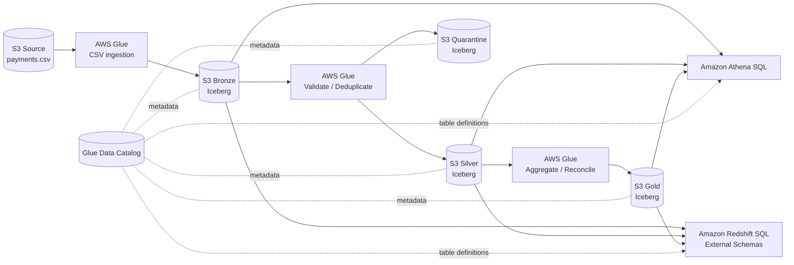

# AWS Payments Lakehouse PoC — S3 → Glue → Iceberg → Athena & Redshift

A reproducible, end-to-end demo for a wider engineering team. It uses **10 synthetic GBP payments** to demonstrate a medallion architecture, AWS Glue PySpark transformations, Apache Iceberg tables in Amazon S3, AWS Glue Data Catalog, and SQL analytics in Athena and Amazon Redshift.

> **Scope:** Batch CSV ingestion only. No RDS, streaming, CDC, Databricks, or incremental MERGE. Bronze/Silver/Gold are **full-snapshot refreshes** for this lab. The example data represents **payment statuses**, not a double-entry financial ledger.

## 1. Architecture



The diagram is **Mermaid embedded directly in this Markdown file** (no separate image needed). GitHub renders it automatically. If your Markdown viewer does not support Mermaid, follow the flow: **S3 Source → Glue → Bronze → Glue + Catalog → Silver → Glue + Catalog → Gold → Athena / Redshift**, with a quarantine branch from Silver validation.

### What each layer means

| Layer | Purpose | Primary table |
|---|---|---|
| Source | Raw CSV supplied by upstream payments system | `s3://<bucket>/source/payments.csv` |
| Bronze | Preserve source records and add ingestion lineage | `payments_bronze.payment_events` |
| Silver | Validate, standardize, deduplicate, quarantine bad data | `payments_silver.payment_events`, `payments_silver.payment_quarantine` |
| Gold | Publish business-facing merchant and daily KPIs | `payments_gold.merchant_daily_kpis`, `payments_gold.daily_payment_kpis` |
| Consumption | Query the same cataloged Iceberg data without copying it | Athena and Redshift external tables |

## 2. Prerequisites and one-time setup

- AWS account with permission to use S3, Glue, IAM, Athena, and Redshift; **region `eu-west-2`**.
- AWS CloudShell (for CLI commands) and AWS Glue Studio (for job scripts).
- An S3 location configured for **Athena query results** (Athena → Settings → Manage).
- Permissions to create a Glue execution IAM role (`PaymentsGluePoCRole`) and attach the policies documented below. In a governed environment, configure Lake Formation access and KMS permissions as well.
- Glue **5.0**, Spark with Iceberg support. Use **2 × G.1X** workers and a short job timeout for this small dataset; Glue charges apply.

### 2.1 Create S3 bucket and Glue databases

Run in **CloudShell**:

```bash
export AWS_REGION=eu-west-2
export ACCOUNT_ID=$(aws sts get-caller-identity --query Account --output text)
export BUCKET="payments-lakehouse-${ACCOUNT_ID}-${AWS_REGION}"

aws s3api create-bucket \
  --bucket "$BUCKET" \
  --region "$AWS_REGION" \
  --create-bucket-configuration LocationConstraint="$AWS_REGION"

aws s3api put-public-access-block --bucket "$BUCKET" \
  --public-access-block-configuration \
  BlockPublicAcls=true,IgnorePublicAcls=true,BlockPublicPolicy=true,RestrictPublicBuckets=true

for DB in payments_bronze payments_silver payments_gold; do
  aws glue create-database \
    --database-input "{\"Name\":\"$DB\"}" \
    --region "$AWS_REGION"
done
```

If the bucket or a database already exists, skip its creation. The bucket name is globally unique; change it if already taken, and use that name consistently below.

### 2.2 Create the AWS Glue execution IAM role

Run the following in **CloudShell** after exporting `BUCKET`, `AWS_REGION` and `ACCOUNT_ID` above. This role is used by all three Glue ETL jobs, not by Redshift.

**Trust policy** — allow AWS Glue to assume the role:

```bash
cat > glue-trust.json <<'JSON'
{
  "Version": "2012-10-17",
  "Statement": [{
    "Effect": "Allow",
    "Principal": {"Service": "glue.amazonaws.com"},
    "Action": "sts:AssumeRole"
  }]
}
JSON

aws iam create-role \
  --role-name PaymentsGluePoCRole \
  --assume-role-policy-document file://glue-trust.json

aws iam attach-role-policy \
  --role-name PaymentsGluePoCRole \
  --policy-arn arn:aws:iam::aws:policy/service-role/AWSGlueServiceRole
```

**S3 access policy** — read the source, write Iceberg data and metadata, and list the demo bucket:

```bash
cat > glue-s3-policy.json <<EOF_POLICY
{
  "Version": "2012-10-17",
  "Statement": [
    {
      "Effect": "Allow",
      "Action": ["s3:ListBucket", "s3:GetBucketLocation"],
      "Resource": "arn:aws:s3:::$BUCKET"
    },
    {
      "Effect": "Allow",
      "Action": [
        "s3:GetObject", "s3:PutObject", "s3:DeleteObject",
        "s3:AbortMultipartUpload", "s3:ListMultipartUploadParts"
      ],
      "Resource": "arn:aws:s3:::$BUCKET/*"
    }
  ]
}
EOF_POLICY

aws iam put-role-policy \
  --role-name PaymentsGluePoCRole \
  --policy-name PaymentsLakehouseS3Access \
  --policy-document file://glue-s3-policy.json
```

The managed `AWSGlueServiceRole` policy supplies standard Glue and CloudWatch Logs permissions; the inline policy grants access to this PoC bucket. For stricter production isolation, narrow S3 prefixes and Glue Catalog resource permissions. If your organization uses **Lake Formation** or **SSE-KMS**, configure the corresponding table/location grants and KMS key permissions too. IAM role creation requires sufficient administrative privileges, and an existing role should be reviewed rather than recreated.

### 2.3 Glue job configuration (use for all three jobs)

In **AWS Glue → ETL jobs → Script editor**, create a Spark/Python job with:

| Setting | Value |
|---|---|
| Glue version | `5.0` |
| IAM role | `PaymentsGluePoCRole` |
| Worker type / number | `G.1X` / `2` |
| Timeout | `10 minutes` (adjust if startup needs longer) |
| `--datalake-formats` | `iceberg` |
| `--BUCKET` | Your bucket name, e.g. `payments-lakehouse-123456789012-eu-west-2` |
| `--conf` | Iceberg Spark settings shown below |

**Single `--conf` job argument value** (replace `<bucket>`):

```text
spark.sql.extensions=org.apache.iceberg.spark.extensions.IcebergSparkSessionExtensions --conf spark.sql.catalog.glue_catalog=org.apache.iceberg.spark.SparkCatalog --conf spark.sql.catalog.glue_catalog.warehouse=s3://<bucket>/ --conf spark.sql.catalog.glue_catalog.catalog-impl=org.apache.iceberg.aws.glue.GlueCatalog --conf spark.sql.catalog.glue_catalog.io-impl=org.apache.iceberg.aws.s3.S3FileIO
```

The Glue databases are the catalog namespaces; Spark refers to them as `glue_catalog.payments_bronze`, `glue_catalog.payments_silver`, and `glue_catalog.payments_gold`. **Do not** set `--BUCKET` to an `s3://` URI: use the bare bucket name.

## 3. Source: upload 10 sample payment records

Create the file in CloudShell:

```bash
cat > payments.csv <<'CSV'
event_id,payment_id,merchant_id,event_type,payment_method,amount,currency,status,event_time
E001,P001,M001,PAYMENT,CARD,100.00,GBP,COMPLETED,2026-10-20T09:00:00
E002,P002,M001,PAYMENT,BANK_TRANSFER,250.00,GBP,COMPLETED,2026-10-20T09:05:00
E003,P003,M002,PAYMENT,CARD,75.00,GBP,FAILED,2026-10-20T09:10:00
E004,P004,M002,PAYMENT,CARD,150.00,GBP,PENDING,2026-10-20T09:15:00
E005,P005,M001,PAYMENT,CARD,300.00,GBP,COMPLETED,2026-10-20T09:20:00
E006,P006,M003,PAYMENT,BANK_TRANSFER,500.00,GBP,COMPLETED,2026-10-20T09:25:00
E007,P007,M003,PAYMENT,CARD,120.00,GBP,COMPLETED,2026-10-20T09:30:00
E008,P008,M002,PAYMENT,CARD,200.00,GBP,REFUNDED,2026-10-20T09:35:00
E009,P009,M001,PAYMENT,CARD,400.00,GBP,COMPLETED,2026-10-20T09:40:00
E010,P010,M003,PAYMENT,CARD,180.00,GBP,CHARGEBACK,2026-10-20T09:45:00
CSV

aws s3 cp payments.csv "s3://$BUCKET/source/payments.csv"
aws s3 ls "s3://$BUCKET/source/"
```

**Expected:** 10 payment rows, 3 merchants, 5 statuses, all GBP. Total recorded amount = **£2,275**; completed-status amount = **£1,670**.

## 4. Glue job 01 — S3 Source → S3 Bronze Iceberg

**Job name:** `payments-s3-to-bronze`

**What it does:** Reads CSV with explicit types, adds `ingestion_time`, `source_system`, and `source_file`, then writes an Iceberg table registered in Glue Data Catalog. The lab uses a full-snapshot overwrite, so rerunning does not append duplicate records.

Paste this **entire PySpark script** into the job editor:

```python
import sys
from awsglue.utils import getResolvedOptions
from awsglue.context import GlueContext
from pyspark.context import SparkContext
from pyspark.sql import functions as F, types as T

args = getResolvedOptions(sys.argv, ["BUCKET"])
bucket = args["BUCKET"]
spark = GlueContext(SparkContext.getOrCreate()).spark_session
spark.conf.set("spark.sql.session.timeZone", "UTC")

table = "glue_catalog.payments_bronze.payment_events"
source_path = f"s3://{bucket}/source/payments.csv"

schema = T.StructType([
    T.StructField("event_id", T.StringType()),
    T.StructField("payment_id", T.StringType()),
    T.StructField("merchant_id", T.StringType()),
    T.StructField("event_type", T.StringType()),
    T.StructField("payment_method", T.StringType()),
    T.StructField("amount", T.DecimalType(18, 2)),
    T.StructField("currency", T.StringType()),
    T.StructField("status", T.StringType()),
    T.StructField("event_time", T.StringType()),
])

raw = (spark.read.option("header", "true")
       .option("mode", "FAILFAST")
       .schema(schema).csv(source_path))

bronze = (raw
    .withColumn("event_time", F.to_timestamp("event_time", "yyyy-MM-dd'T'HH:mm:ss"))
    .withColumn("ingestion_time", F.current_timestamp())
    .withColumn("source_system", F.lit("S3_CSV_POC"))
    .withColumn("source_file", F.input_file_name()))

assert bronze.count() == 10, "Unexpected source record count"
bronze.createOrReplaceTempView("bronze_input")

spark.sql(f"""
CREATE TABLE IF NOT EXISTS {table} (
    event_id STRING, payment_id STRING, merchant_id STRING,
    event_type STRING, payment_method STRING, amount DECIMAL(18,2),
    currency STRING, status STRING, event_time TIMESTAMP,
    ingestion_time TIMESTAMP, source_system STRING, source_file STRING
)
USING iceberg
LOCATION 's3://{bucket}/bronze/payment_events/'
TBLPROPERTIES ('format-version'='2')
""")

spark.sql(f"""
INSERT OVERWRITE {table}
SELECT event_id, payment_id, merchant_id, event_type, payment_method,
       amount, currency, status, event_time,
       ingestion_time, source_system, source_file
FROM bronze_input
""")

assert spark.table(table).count() == 10
print("BRONZE COMPLETE: 10 records")
```

**Run:** Save → Run → verify job status `Succeeded`.

**Athena SQL (Bronze):**

```sql
SELECT event_id, payment_id, merchant_id, amount, status, ingestion_time
FROM payments_bronze.payment_events
ORDER BY event_id;

SELECT COUNT(*) AS rows, SUM(amount) AS recorded_amount
FROM payments_bronze.payment_events;
-- Expected: 10, 2275.00
```

## 5. Glue job 02 — Bronze → Silver + Quarantine

**Job name:** `payments-bronze-to-silver`

**What it does:** Applies data-quality checks, deduplicates valid records by `event_id` using `ROW_NUMBER`, enriches payment date, and writes **two** cataloged Iceberg tables: accepted Silver payments and rejected/quarantined payments.

**Demo test injection:** Because the original CSV contains 10 valid unique records, this script adds **three in-memory test rows**: one duplicate `E001`, one negative-amount payment, and one unsupported-currency payment. These test rows are **not** written back to Bronze.

```python
import sys
from awsglue.utils import getResolvedOptions
from awsglue.context import GlueContext
from pyspark.context import SparkContext
from pyspark.sql import functions as F
from pyspark.sql.window import Window

args = getResolvedOptions(sys.argv, ["BUCKET"])
bucket = args["BUCKET"]
spark = GlueContext(SparkContext.getOrCreate()).spark_session
spark.conf.set("spark.sql.session.timeZone", "UTC")

bronze_table = "glue_catalog.payments_bronze.payment_events"
silver_table = "glue_catalog.payments_silver.payment_events"
quarantine_table = "glue_catalog.payments_silver.payment_quarantine"

bronze = spark.table(bronze_table)
assert bronze.count() == 10

# Add three synthetic cases to this job only.
duplicate = bronze.filter(F.col("event_id") == "E001")
base = bronze.filter(F.col("event_id") == "E001").limit(1)
negative = (base.withColumn("event_id", F.lit("E011"))
    .withColumn("payment_id", F.lit("P011"))
    .withColumn("amount", F.lit(-50).cast("decimal(18,2)")))
bad_currency = (base.withColumn("event_id", F.lit("E012"))
    .withColumn("payment_id", F.lit("P012"))
    .withColumn("currency", F.lit("XYZ")))

input_df = bronze.unionByName(duplicate).unionByName(negative).unionByName(bad_currency)
assert input_df.count() == 13

# Compose an explanation for each invalid record.
validated = input_df.withColumn(
    "validation_error",
    F.concat_ws("; ",
        F.when(F.col("event_id").isNull() | (F.trim("event_id") == ""), "missing event_id"),
        F.when(F.col("payment_id").isNull() | (F.trim("payment_id") == ""), "missing payment_id"),
        F.when(F.col("merchant_id").isNull() | (F.trim("merchant_id") == ""), "missing merchant_id"),
        F.when(F.col("amount").isNull() | (F.col("amount") <= 0), "invalid amount"),
        F.when(F.col("currency").isNull() | ~F.upper(F.col("currency")).isin("GBP", "EUR", "USD"), "invalid currency"),
        F.when(F.col("status").isNull() | ~F.upper(F.col("status")).isin(
            "COMPLETED", "FAILED", "PENDING", "REFUNDED", "CHARGEBACK"), "invalid status"),
        F.when(F.col("event_time").isNull(), "missing event_time")
    )
)

quarantine = validated.filter(F.col("validation_error") != "")
valid = validated.filter(F.col("validation_error") == "").drop("validation_error")

# Deterministic for the exact duplicate E001 injected above.
# Production needs an authoritative source sequence for conflicting payloads.
w = Window.partitionBy("event_id").orderBy(
    F.col("ingestion_time").desc(), F.col("source_file").asc())

silver = (valid.withColumn("rn", F.row_number().over(w))
    .filter(F.col("rn") == 1).drop("rn")
    .withColumn("currency", F.upper("currency"))
    .withColumn("status", F.upper("status"))
    .withColumn("payment_date", F.to_date("event_time"))
    .withColumn("amount_gbp", F.when(F.col("currency") == "GBP", F.col("amount"))
                .otherwise(F.lit(None).cast("decimal(18,2)")))
    .withColumn("silver_processed_at", F.current_timestamp()))

assert quarantine.count() == 2
assert silver.count() == 10
assert silver.select("event_id").distinct().count() == 10

# Explicit schemas make Athena/Redshift column types predictable.
spark.sql(f"""
CREATE TABLE IF NOT EXISTS {silver_table} (
    event_id STRING, payment_id STRING, merchant_id STRING,
    event_type STRING, payment_method STRING, amount DECIMAL(18,2),
    currency STRING, status STRING, event_time TIMESTAMP,
    ingestion_time TIMESTAMP, source_system STRING, source_file STRING,
    payment_date DATE, amount_gbp DECIMAL(18,2), silver_processed_at TIMESTAMP
)
USING iceberg
LOCATION 's3://{bucket}/silver/payment_events/'
TBLPROPERTIES ('format-version'='2')
""")

spark.sql(f"""
CREATE TABLE IF NOT EXISTS {quarantine_table} (
    event_id STRING, payment_id STRING, merchant_id STRING,
    event_type STRING, payment_method STRING, amount DECIMAL(18,2),
    currency STRING, status STRING, event_time TIMESTAMP,
    ingestion_time TIMESTAMP, source_system STRING, source_file STRING,
    validation_error STRING
)
USING iceberg
LOCATION 's3://{bucket}/quarantine/payment_events/'
TBLPROPERTIES ('format-version'='2')
""")

silver.createOrReplaceTempView("silver_input")
quarantine.createOrReplaceTempView("quarantine_input")

spark.sql(f"""
INSERT OVERWRITE {silver_table}
SELECT event_id, payment_id, merchant_id, event_type, payment_method,
       amount, currency, status, event_time, ingestion_time,
       source_system, source_file, payment_date, amount_gbp, silver_processed_at
FROM silver_input
""")

spark.sql(f"""
INSERT OVERWRITE {quarantine_table}
SELECT event_id, payment_id, merchant_id, event_type, payment_method,
       amount, currency, status, event_time, ingestion_time,
       source_system, source_file, validation_error
FROM quarantine_input
""")

assert spark.table(silver_table).count() == 10
assert spark.table(quarantine_table).count() == 2
print("SILVER COMPLETE: 10 accepted, 2 quarantined, 1 duplicate removed")
```

**Athena SQL (Silver):**

```sql
SELECT COUNT(*) AS accepted, SUM(amount) AS recorded_amount
FROM payments_silver.payment_events;
-- Expected: 10, 2275.00

SELECT event_id, payment_id, validation_error
FROM payments_silver.payment_quarantine
ORDER BY event_id;
-- Expected: E011 invalid amount; E012 invalid currency

SELECT event_id, COUNT(*) AS copies
FROM payments_silver.payment_events
GROUP BY event_id
HAVING COUNT(*) > 1;
-- Expected: no rows
```

## 6. Glue job 03 — Silver → Gold merchant and daily KPIs

**Job name:** `payments-silver-to-gold`

**What it does:** Reads accepted Silver payments, calculates counts and amounts by payment status, publishes one merchant/day table and one platform/day table, and validates the totals before publishing. For this GBP-only sample, all amount totals are in GBP.

```python
import sys
from awsglue.utils import getResolvedOptions
from awsglue.context import GlueContext
from pyspark.context import SparkContext
from pyspark.sql import functions as F

args = getResolvedOptions(sys.argv, ["BUCKET"])
bucket = args["BUCKET"]
spark = GlueContext(SparkContext.getOrCreate()).spark_session
spark.conf.set("spark.sql.session.timeZone", "UTC")

source = "glue_catalog.payments_silver.payment_events"
merchant_table = "glue_catalog.payments_gold.merchant_daily_kpis"
daily_table = "glue_catalog.payments_gold.daily_payment_kpis"

silver = spark.table(source)
assert silver.count() == 10
assert silver.filter(F.col("currency") != "GBP").count() == 0, "Demo expects GBP only"

statuses = ["COMPLETED", "FAILED", "PENDING", "REFUNDED", "CHARGEBACK"]

def metrics(df, keys):
    expressions = [
        F.count("*").alias("total_payments"),
        F.sum("amount").cast("decimal(20,2)").alias("total_recorded_amount"),
    ]
    for status in statuses:
        alias = status.lower()
        expressions.append(F.sum(F.when(F.col("status") == status, 1)
                                 .otherwise(0)).alias(f"{alias}_count"))
        expressions.append(F.sum(F.when(F.col("status") == status, F.col("amount"))
                                 .otherwise(F.lit(0))).cast("decimal(20,2)")
                           .alias(f"{alias}_amount"))
    return (df.groupBy(*keys).agg(*expressions)
        .withColumn("completion_rate_pct",
            F.round(F.col("completed_count") * F.lit(100.0) /
                    F.col("total_payments"), 2)))

merchant = metrics(silver, ["payment_date", "merchant_id"])
daily = metrics(silver, ["payment_date"]).join(
    silver.groupBy("payment_date")
          .agg(F.countDistinct("merchant_id").alias("active_merchants")),
    "payment_date")

# Validate before writing any Gold table.
assert merchant.count() == 3
assert daily.count() == 1
check = merchant.agg(F.sum("total_payments").alias("n"),
                     F.sum("total_recorded_amount").alias("amount"),
                     F.sum("completed_amount").alias("completed")).first()
assert check["n"] == 10 and check["amount"] == 2275 and check["completed"] == 1670

# The same metric columns are used by both Gold tables.
metric_ddl = """
    total_payments BIGINT,
    total_recorded_amount DECIMAL(20,2),
    completed_count BIGINT, completed_amount DECIMAL(20,2),
    failed_count BIGINT, failed_amount DECIMAL(20,2),
    pending_count BIGINT, pending_amount DECIMAL(20,2),
    refunded_count BIGINT, refunded_amount DECIMAL(20,2),
    chargeback_count BIGINT, chargeback_amount DECIMAL(20,2),
    completion_rate_pct DOUBLE
"""

spark.sql(f"""
CREATE TABLE IF NOT EXISTS {merchant_table} (
    payment_date DATE, merchant_id STRING, {metric_ddl}
)
USING iceberg
LOCATION 's3://{bucket}/gold/merchant_daily_kpis/'
TBLPROPERTIES ('format-version'='2')
""")

spark.sql(f"""
CREATE TABLE IF NOT EXISTS {daily_table} (
    payment_date DATE, {metric_ddl}, active_merchants BIGINT
)
USING iceberg
LOCATION 's3://{bucket}/gold/daily_payment_kpis/'
TBLPROPERTIES ('format-version'='2')
""")

metric_columns = ["total_payments", "total_recorded_amount"]
for s in statuses:
    metric_columns += [f"{s.lower()}_count", f"{s.lower()}_amount"]
metric_columns += ["completion_rate_pct"]

merchant.select("payment_date", "merchant_id", *metric_columns) \
    .createOrReplaceTempView("merchant_output")
daily.select("payment_date", *metric_columns, "active_merchants") \
    .createOrReplaceTempView("daily_output")

spark.sql(f"INSERT OVERWRITE {merchant_table} SELECT * FROM merchant_output")
spark.sql(f"INSERT OVERWRITE {daily_table} SELECT * FROM daily_output")

assert spark.table(merchant_table).count() == 3
assert spark.table(daily_table).count() == 1
print("GOLD COMPLETE: 3 merchant rows, 1 daily row")
```

**Athena SQL (Gold):**

```sql
SELECT merchant_id, total_payments, completed_count,
       completed_amount, completion_rate_pct
FROM payments_gold.merchant_daily_kpis
ORDER BY merchant_id;

SELECT payment_date, total_payments, active_merchants,
       completed_count, completed_amount, completion_rate_pct
FROM payments_gold.daily_payment_kpis;
```

**Expected merchant KPIs:**

| Merchant | Payments | Completed | Completed amount | Completion rate |
|---|---:|---:|---:|---:|
| M001 | 4 | 4 | £1,050 | 100.00% |
| M002 | 3 | 0 | £0 | 0.00% |
| M003 | 3 | 2 | £620 | 66.67% |

**Expected platform KPIs:** 10 payments, 3 merchants, 6 completed, **£1,670** completed-status amount, **60%** completion rate.

## 7. Reconciliation: Bronze → Silver → Gold

Run in **Athena** to prove all layers agree:

```sql
WITH bronze AS (
    SELECT COUNT(*) AS n, SUM(amount) AS amount
    FROM payments_bronze.payment_events
), silver AS (
    SELECT COUNT(*) AS n, SUM(amount) AS amount
    FROM payments_silver.payment_events
), gold AS (
    SELECT SUM(total_payments) AS n,
           SUM(total_recorded_amount) AS amount
    FROM payments_gold.merchant_daily_kpis
)
SELECT bronze.n AS bronze_count,
       silver.n AS silver_count,
       gold.n AS gold_count,
       bronze.amount AS bronze_amount,
       silver.amount AS silver_amount,
       gold.amount AS gold_amount,
       CASE WHEN bronze.n = silver.n AND silver.n = gold.n
                 AND bronze.amount = silver.amount
                 AND silver.amount = gold.amount
            THEN 'PASS' ELSE 'FAIL' END AS reconciliation
FROM bronze CROSS JOIN silver CROSS JOIN gold;
-- Expected: 10 / 10 / 10; 2275 / 2275 / 2275; PASS
```

**Financial interpretation:** `total_recorded_amount` includes FAILED, PENDING, REFUNDED and CHARGEBACK payment rows. It is **not** settled revenue or net cash movement. Likewise, `refunded_amount` and `chargeback_amount` measure amounts of payments *currently in those statuses*, not independently booked refund/chargeback ledger entries. True financial reconciliation needs transaction, refund, fee and settlement event records.

## 8. Redshift Serverless — query Bronze, Silver and Gold

**Goal:** Use Redshift SQL against the **same Iceberg tables** in S3 via Glue Data Catalog, without copying the data into Redshift.

### 8.1 Create Redshift Serverless resources

In **Amazon Redshift → Serverless**, create:

- Namespace: `payments-poc-ns`
- Workgroup: `payments-poc-wg`
- Database: `dev`
- Region: `eu-west-2`
- Smallest supported base capacity for your region/account; set a usage limit and budget.
- Private network access and IAM-based Query Editor v2 access as appropriate.

**Cost note:** Redshift Serverless, Glue, Athena scans, S3, and CloudWatch may incur charges. Stop and remove demo resources when finished.

### 8.2 Create Redshift's read-only IAM role

Redshift needs its **own role** with permission to read the S3 Iceberg objects and Glue metadata. In CloudShell:

```bash
cat > redshift-trust.json <<'JSON'
{
  "Version": "2012-10-17",
  "Statement": [{
    "Effect": "Allow",
    "Principal": {"Service": "redshift.amazonaws.com"},
    "Action": "sts:AssumeRole"
  }]
}
JSON

aws iam create-role \
  --role-name PaymentsRedshiftRole \
  --assume-role-policy-document file://redshift-trust.json

cat > redshift-read-policy.json <<EOF_POLICY
{
  "Version": "2012-10-17",
  "Statement": [
    {
      "Effect": "Allow",
      "Action": ["s3:ListBucket", "s3:GetBucketLocation"],
      "Resource": "arn:aws:s3:::$BUCKET"
    },
    {
      "Effect": "Allow",
      "Action": "s3:GetObject",
      "Resource": [
        "arn:aws:s3:::$BUCKET/bronze/*",
        "arn:aws:s3:::$BUCKET/silver/*",
        "arn:aws:s3:::$BUCKET/quarantine/*",
        "arn:aws:s3:::$BUCKET/gold/*"
      ]
    },
    {
      "Effect": "Allow",
      "Action": ["glue:GetDatabase", "glue:GetDatabases",
                 "glue:GetTable", "glue:GetTables", "glue:GetPartitions"],
      "Resource": [
        "arn:aws:glue:$AWS_REGION:$ACCOUNT_ID:catalog",
        "arn:aws:glue:$AWS_REGION:$ACCOUNT_ID:database/payments_bronze",
        "arn:aws:glue:$AWS_REGION:$ACCOUNT_ID:database/payments_silver",
        "arn:aws:glue:$AWS_REGION:$ACCOUNT_ID:database/payments_gold",
        "arn:aws:glue:$AWS_REGION:$ACCOUNT_ID:table/payments_bronze/*",
        "arn:aws:glue:$AWS_REGION:$ACCOUNT_ID:table/payments_silver/*",
        "arn:aws:glue:$AWS_REGION:$ACCOUNT_ID:table/payments_gold/*"
      ]
    }
  ]
}
EOF_POLICY

aws iam put-role-policy \
  --role-name PaymentsRedshiftRole \
  --policy-name PaymentsLakehouseReadOnly \
  --policy-document file://redshift-read-policy.json
```

Attach `PaymentsRedshiftRole` to the **Redshift Serverless namespace** in its IAM role settings. Grant any required Lake Formation permissions if applicable. S3 SSE-KMS encryption requires corresponding KMS decrypt permissions.

### 8.3 Create external schemas in Redshift Query Editor v2

Replace `<ACCOUNT_ID>` with your 12-digit AWS account ID. Connect to database `dev`:

```sql
CREATE EXTERNAL SCHEMA payments_bronze_ext
FROM DATA CATALOG
DATABASE 'payments_bronze'
REGION 'eu-west-2'
IAM_ROLE 'arn:aws:iam::<ACCOUNT_ID>:role/PaymentsRedshiftRole';

CREATE EXTERNAL SCHEMA payments_silver_ext
FROM DATA CATALOG
DATABASE 'payments_silver'
REGION 'eu-west-2'
IAM_ROLE 'arn:aws:iam::<ACCOUNT_ID>:role/PaymentsRedshiftRole';

CREATE EXTERNAL SCHEMA payments_gold_ext
FROM DATA CATALOG
DATABASE 'payments_gold'
REGION 'eu-west-2'
IAM_ROLE 'arn:aws:iam::<ACCOUNT_ID>:role/PaymentsRedshiftRole';
```

Redshift Spectrum's Iceberg support and supported types/features depend on the current Redshift engine. Check your workgroup version and AWS documentation if an external Iceberg table is not queryable.

### 8.4 Redshift SQL across all three layers

```sql
-- Bronze: ingested source
SELECT COUNT(*) AS bronze_rows, SUM(amount) AS bronze_amount
FROM payments_bronze_ext.payment_events;

-- Silver: validated records
SELECT status, COUNT(*) AS payments, SUM(amount) AS recorded_amount
FROM payments_silver_ext.payment_events
GROUP BY status
ORDER BY status;

-- Silver quarantine: data-quality evidence
SELECT event_id, validation_error
FROM payments_silver_ext.payment_quarantine
ORDER BY event_id;

-- Gold: merchant performance
SELECT merchant_id, total_payments, completed_count,
       completed_amount, completion_rate_pct
FROM payments_gold_ext.merchant_daily_kpis
ORDER BY merchant_id;

-- Gold: platform daily performance
SELECT payment_date, total_payments, active_merchants,
       completed_count, completed_amount
FROM payments_gold_ext.daily_payment_kpis;
```

**Cross-engine check:** Run the equivalent queries in Athena (remove `_ext` from the database names). Both engines should show the same logical data for the same Iceberg snapshot.

## 9. Suggested 10-minute team demo

| Minute | Demonstration | Key message |
|---|---|---|
| 0–1 | Architecture and S3 source CSV | One small payment dataset, layered design |
| 1–3 | Run Glue Bronze job; Athena Bronze SQL | Schema-on-ingest, metadata and catalog |
| 3–5 | Run Silver job; inspect quarantine | Validation, deduplication and auditability |
| 5–7 | Run Gold job; query merchant KPIs | Trusted business metrics |
| 7–8 | Run Athena reconciliation SQL | Layer-by-layer correctness |
| 8–10 | Query Gold from Redshift | Shared Iceberg data, two SQL engines |

### Success criteria

- **Bronze:** 10 records, £2,275 recorded amount.
- **Silver:** 10 accepted, 2 quarantined, 1 duplicate test record removed.
- **Gold:** 3 merchant rows, 1 daily row, £1,670 completed-status amount.
- **Reconciliation:** Bronze = Silver = Gold (10 rows / £2,275).
- **Athena and Redshift:** Matching results against cataloged Iceberg tables.
- **Replay:** Rerunning each Glue job produces the same logical counts (new Iceberg snapshots may still be created).

## 10. Operational notes and cleanup

**Production differences:** Replace hard-coded assertions with data-quality thresholds; preserve immutable raw input; add ingestion batch IDs, schema evolution controls, observability, alerting, access governance, and retry orchestration. Use deterministic event sequencing for true payment lifecycle updates. Two Gold tables are published independently, so this PoC does not offer a single atomic commit across both tables.

**Cleanup:** Delete the Redshift workgroup/namespace when no longer needed, then remove disposable Glue jobs and Glue Catalog tables. **Do not delete shared buckets or data.** If this bucket was created exclusively for the PoC, review its contents and costs before deleting it. S3 Iceberg metadata/data files may remain after catalog table deletion.

---

**Run order:** Source upload → `payments-s3-to-bronze` → `payments-bronze-to-silver` → `payments-silver-to-gold` → Athena validation → Redshift external schemas and SQL.
